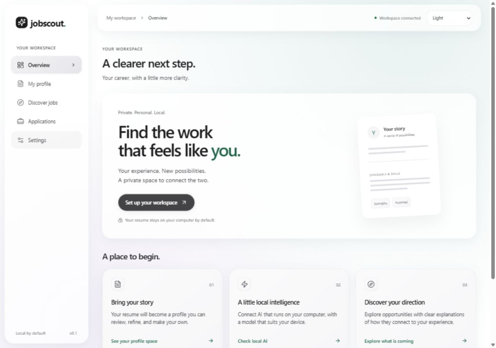
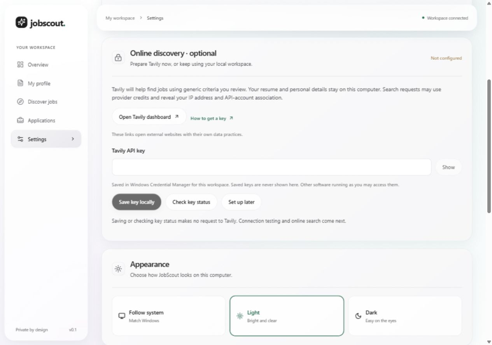
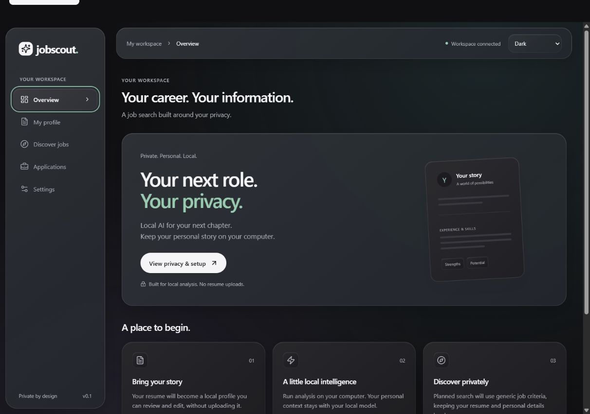
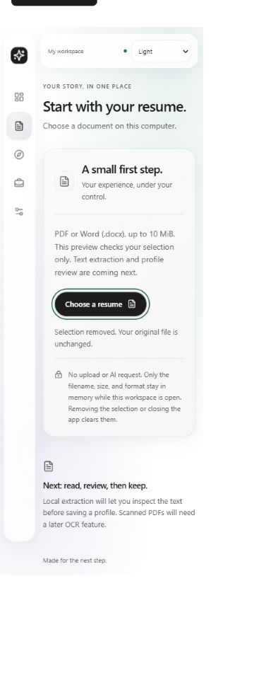
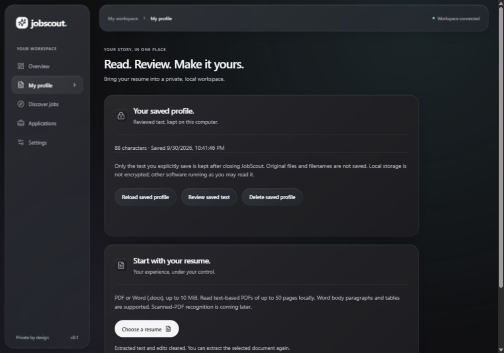

# JobScout Local

Find your next role. Keep your personal story private.

JobScout is a closed-source Windows application distributed to users as an installer, designed to keep resumes, AI analysis, and career records on your computer. Its defining promise is local intelligence without uploading your personal career data.

This repository and its development instructions are for authorized maintainers. Source, internal documentation, tests and build reports are not public deliverables. The [distribution decision](docs/architecture/0042-private-source-installer-distribution.md) applies prospectively and preserves historical MIT and third-party rights. Installer packaging does not make executable code impossible to inspect. The owner will change the existing public repository's visibility; no new source publication is permitted while it remains public.

**Status: early development, version 0.1.0, updated 2026-10-21.** Local resume import/review/storage, explicit Tavily discovery, local evidence and filters, candidate saving, private application tracking, reviewed data deletion and guided core setup are implemented. The current local Windows installer includes setup steps 22A–22D and collected dependency notices; the earlier bounded installed folder-change walkthrough retains its original artifact scope. Search-quality acceptance and broader Windows release checks remain open. No v1.0 release has been made. The current workflow uses deterministic local analysis and requires no model download; local LLM summaries and embeddings are planned.

The workspace has Find jobs with Resume → Job options/Review query → Results steps, plus Saved jobs and Settings. Save candidate keeps a returned snapshot on this computer; source/retrieval time survives restart and confirmed removal deletes the local copy. Same-link saves keep the first snapshot, with a 200-record limit and no automatic eviction. Saving does not verify suitability or freshness. Clearing results or deleting the profile keeps saved candidates. Saved jobs now supports user-recorded Saved/Applied/Interview stages and up to 4,000 characters of private notes through Edit stage and notes → Save changes. Tracking sends nothing online or to an employer; notes survive restart and confirmed candidate removal deletes them. See [the saving contract](docs/architecture/0032-bounded-local-job-snapshots.md) and [tracking contract](docs/architecture/0033-private-application-tracking.md). Historical screenshots below show earlier layouts and appearance treatments; they do not represent the current navigation.

The optional [three-step setup guide](docs/architecture/0038-guided-core-setup.md) opens from the resume screen or Settings: Your workspace → Online search → First use. Back, Continue and Finish later keep setup optional; reopening remembers only the current step. It offers local storage checks, reviewed personal-data folder changes, optional Tavily setup and first-use guidance. It never automatically checks a provider, searches or downloads a model.

Your workspace → Check storage shows the configured personal-data folder and current free drive space. First use → Run local check separately reads bounded device facts and writes, reads and removes one tiny nonpersonal test file in that folder. Results are transient; success does not certify performance, database durability or future saves. See [storage inspection](docs/architecture/0039-local-storage-inspection.md) and [local core checks](docs/architecture/0040-local-core-readiness.md).

Change personal-data folder accepts a full path for a **new folder inside an existing local fixed-drive folder**. Review folder change checks the destination and space; Copy and use this folder explicitly copies and verifies saved profile text, jobs, stages and notes before switching active storage. Choose a location outside cloud sync. The provider key stays in Windows Credential Manager, and application files, original resumes and models stay in place. Later saves/deletion affect only the active database; original recovery copies and interrupted destination copies remain. Keep the original launch directory for routing and credential identity, and do not open a relocated workspace with an older app version. A native folder picker and automatic recovery-copy restoration/cleanup are planned follow-ups. See [the folder-change contract](docs/architecture/0041-personal-data-folder.md).



Choose Light, Dark, or Follow system from the appearance control in Settings. Reduce transparency provides solid surfaces without blur; Reduce motion turns off interface animations and transitions. These independent choices are remembered locally and add to system accessibility preferences when exposed. The Windows app uses the same interface in a Tauri desktop window; the browser preview is a development convenience.

Settings offers optional Tavily key setup: masked entry, Show/Hide, explicit save/replace/remove, local status and setup later. Keys use Windows Credential Manager separately for each workspace; there is no plaintext fallback. Saving/checking local key status makes no provider request. A separately reviewed connection check sends only the saved credential to the fixed HTTPS account-usage endpoint, with no resume or job criteria. Key acceptance does not guarantee credits or authorize a search. Find jobs requires confirmation of the actual engine query before dispatch. Stop waiting cannot recall a sent request. Saved keys are retained after uninstall; remove them in Settings or Windows Credential Manager. See [the credential contract](docs/architecture/0009-search-provider-secrets.md) and [connection-check contract](docs/architecture/0010-provider-connection-check.md).





The Resume step reads local text-based PDFs (up to 10 pages) and Word DOCX documents up to 10 MiB. Choosing a file starts extraction in a bounded, cancellable local worker. Review and correct the text, then select Generate suggested search to mark it reviewed and prepare local category suggestions. Saving is optional and explicit; imports and edits do not save automatically. Closing the app clears unsaved drafts. Word body paragraphs and tables are supported; headers, footers, images and embedded documents are omitted. Scanned PDFs need OCR, which is not implemented. Linked resources are never fetched.



The interface uses shared glass materials for navigation, panels, and controls, with responsive layouts and opaque accessibility fallbacks. See [the glass design rules](docs/design/glass.md). This is a Windows-compatible CSS treatment inspired by Liquid Glass; native Windows rendering and performance still need release checks.

## Run the development preview

Development prerequisites: Node.js 22.12+ (Node 24 recommended) and Python 3.11+. Windows desktop packaging bundles the engine; developers use a virtual environment.

Windows PowerShell, from the repository root:

```powershell
py -3.12 -m venv .venv
.\.venv\Scripts\python.exe -m pip install -e ".[dev]"
npm ci
npm run dev
```

If Python is installed under another name, use that executable to create `.venv`. An existing environment can be selected with `JOBSCOUT_PYTHON`. The Node scripts do not auto-load `.env` files; `.env.example` documents shell overrides.

Open [the development preview](http://127.0.0.1:1420). This starts both the real engine and the React interface. Press Ctrl+C to stop them. The engine uses an available loopback port and a random session credential. Preview database files are stored in `.local/`, which is ignored by Git.

For interactive checks with synthetic data and no live search or saved-key access, use `npm run acceptance:preview` at browser port 1421, or `npm run acceptance:native` for the Windows shell with a separate frozen mock sidecar at port 1422. Both accept `-- failure` for partial-result recovery checks. The native harness uses a separate test application identifier and fresh temporary database; close its window normally to finish. See [the acceptance preview guide](docs/acceptance-preview.md) and [milestone 17 evidence](docs/milestone17-acceptance.md).

Ollama is optional; its availability check does not enable model inference. When it is absent, the workspace continues running. No model downloads or search-provider requests run automatically.

## Run as a Windows desktop app

Install the official [Tauri Windows prerequisites](https://v2.tauri.app/start/prerequisites/): Rust with the MSVC toolchain, Microsoft C++ Build Tools, and WebView2 where needed.

In the Microsoft installer, select **Desktop development with C++**, including the MSVC x64/x86 tools and a Windows SDK. Rust alone is insufficient. If packaging reports that `RC.EXE` is missing, use Visual Studio Installer to install or repair the Windows SDK and C++ tools, then reopen your terminal and retry. A leftover Windows Kits folder does not prove the resource compiler or SDK libraries are installed. Do not replace a missing compiler with an older JobScout executable; rebuild the paired package below.

With these prerequisites ready:

```powershell
.\.venv\Scripts\python.exe -m pip install -e ".[desktop]"
npm run desktop:dev
```

This packages the engine as a sidecar, starts Vite, and opens the Tauri window. Tauri owns the engine process and shuts it down when the application exits. Native app data starts in the OS application-data folder for `app.jobscout.local`; reviewed folder changes relocate career records while keeping the original routing and credential identity.

Managed desktop development uses the ignored `work/desktop-dev` Cargo cache, separate from direct Cargo checks and release packaging. The first run rebuilds this cache; later runs reuse it. An explicit `CARGO_TARGET_DIR` override is respected.

If Tauri's build helper reports `Access is denied` while replacing `jobscout-engine.exe`, a running sidecar may be locking that build directory. Close the associated JobScout app and its development command normally before retrying. Use `npm run desktop:dev` from the repository root to select the managed development cache. Avoid running multiple desktop builds against the same cache. If an old elevated/orphaned sidecar cannot be identified safely, restart Windows; do not change filesystem permissions or stop unrelated Python processes. A custom `CARGO_TARGET_DIR` must also be free of running executables.

```powershell
npm run desktop:build
```

With the default target directory, the build creates a Windows NSIS installer under `apps/desktop/src-tauri/target/release/bundle/`. A `CARGO_TARGET_DIR` override moves the release executable and bundles to that directory. Reopen the fresh executable or update the installed app to use new code; an already-running or installed copy is separate. Rebuild/restart frontend and bundled engine together when their strict API contracts change.

For the bounded synthetic installed folder-copy check, follow [the acceptance walkthrough](docs/22d-installed-acceptance.md). It uses a separate application identity and preserves the normal installation; successful packaging alone does not complete installed acceptance.

The guided installer/onboarding design is in [installation.md](docs/design/installation.md). The optional in-app core guide, storage/device checks, personal-data folder changes and Tavily key setup are implemented. An integrated installation/first-run wizard, model selection, custom model storage and download recovery remain planned. The installer is configured for the current Windows user; the generated package is local and has not been published as a release asset.

Production engine packaging, Rust compilation and NSIS generation pass for the current code (latest local installer approximately 22.19 MiB, including 22A–22D). The separate-identity synthetic folder-copy, restart, later-save, normal-close and guarded uninstall walkthrough also passes; see [the observed results](docs/progress/2026-10-20.md). Broader installer wizard, upgrade/fresh-user/runtime, accessibility, OS/theme, active-work and workload-resource checks remain release gates.

## Structure

```text
apps/
  desktop/
    src/                 Resume/search, saved jobs, tracking, setup, Settings and transport
    src-tauri/           Windows shell and engine process lifecycle
  engine/
    src/jobscout_engine/
      domain/            Public criteria, local suggestions/evidence, URL normalization
      adapters/          Restricted Tavily transport and Ollama availability
      app.py             Authenticated local API
      storage.py         SQLite profile, candidate and tracking persistence
      setup_check.py     Explicit device facts and owned temporary-file probe
      setup_storage.py   Local folder and free-space inspection
      workspace_location.py  Reviewed database copying and restart routing
    tests/               Import, storage, setup, privacy, transport and matching checks
scripts/                 Preview and sidecar packaging commands
docs/
  architecture/          Technical boundaries and decisions
  design/                Product flows
```

Parsing, discovery, personal analysis, saved jobs and tracking run in the local engine behind small replaceable interfaces. The search adapter receives only validated public criteria; personal analysis has no provider or credential access. Setup and persistence extend the same modular monolith.

## Check a change

```powershell
npm run typecheck
npm run build
node --experimental-strip-types --test apps/desktop/tests/*.test.mjs
.\.venv\Scripts\python.exe -m pytest
```

Use Node 24 for the full frontend suite above (it uses TypeScript stripping). Exercise both resume and manual flows: review/correction → query preparation → explicit send → Results/filter/back/revise. Check provider setup, cancellation/retry, disconnected behavior, keyboard navigation, both themes, narrow windows and reduced motion using synthetic data. If pytest cannot use the system temp directory in a restricted environment, run it with `-p no:cacheprovider --basetemp=.local/pytest` instead. For native changes, also run `npm run desktop:build` on a prepared Windows machine.

Latest recorded regression evidence (2026-10-19): **454 engine, 162 frontend and 17 report/audit tests pass**, alongside production typecheck/build, synthetic shortlist evaluation and packaged-engine smoke checks. The [2026-10-20 installed walkthrough](docs/progress/2026-10-20.md) adds bounded synthetic folder-copy, restart, preserved tracking, later note-save, local-probe, normal-close and uninstall evidence.

Current core-acceptance validation and applicable browser/native/installed evidence are recorded in [the finite 17D checklist](docs/milestone17-acceptance.md#core-development-exit-checklist). Synthetic captured-request tests check that private fixture markers never enter provider requests. Recorded interactive subsets and bounded live trials do not establish representative search quality, verified vacancies or full Windows release readiness. Those broader gates belong to 21/23. [Milestone 23A](docs/23-ci.md) adds synthetic GitHub Actions validation and dependent Windows packaging; hosted-run/artifact verification and required merge checks remain pending. Run the same checks locally with `npm.cmd run validate:ci`.

## Privacy and local connections

Our product contract is that resume files, extracted text, profiles, embeddings, match explanations, and application notes stay local. The current picker validates filename, size, and operating-system MIME metadata for immediate feedback; the engine independently validates file structure and resource limits. No hosted AI fallback, product analytics, advertising trackers, or automatic uploads of diagnostics are part of the design.

Explicit online discovery uses a restricted search adapter and only reviewed generic job criteria. Resume/profile data stays local. Bounded browser/native subsets and approved live trials have evidence; representative quality and full installed release checks remain pending under milestones 21/23. A search provider can still see queries, connection metadata such as an IP address, and the account associated with an API key; JobScout does not currently provide network anonymity. Opening a job website or applying there creates a separate interaction with that site.

See [the privacy contract](docs/privacy.md) for the exact boundary, implementation requirements, and release checks. Privacy statements must describe verified behavior, not imply that planned safeguards already exist.

The engine binds only to `127.0.0.1`, requires a fresh app-session token on every API request, and does not enable cross-origin access. The browser preview uses narrowly scoped Vite proxy routes; the token is not embedded in frontend assets. Tauri uses fixed Rust commands to reach the engine. Resume bytes go only to this authenticated local engine; optional search credentials use Windows Credential Manager with no plaintext fallback.

## Next milestone

The [resource baseline](docs/resource-baseline.md) includes a reproducible engine benchmark, measured startup/import memory, provisional regression thresholds and limited installed process snapshots. Full desktop workload measurements and resource budgets remain outstanding; individual snapshots do not establish typical memory use or performance recommendations.

The [release plan](docs/releases.md) defines **v1.0 as the model-free Windows core**: local resume review, private discovery, useful shortlist evidence, saved jobs, basic tracking, data controls and guided setup. Optional semantic matching and local AI assistance have later releases. The application is still early development at 0.1.0; no v1.0 release has been made.

The finite [17D core-development checklist](docs/milestone17-acceptance.md#core-development-exit-checklist) passes. **18–20 — saved jobs, tracking and data controls** are implemented. **21 — search-quality review** retains open human usefulness/scope decisions; exhaustive card-by-card grading is deferred under the [delivery amendment](docs/architecture/0037-finite-search-quality-delivery.md#delivery-amendment--2026-10-17). **22 — guided core setup** is implemented through 22D, packaged and verified in a bounded installed walkthrough. **23A — synthetic CI and Windows packaging** is implemented locally; hosted-run/required-check acceptance awaits verified private visibility and authorized publication. **23B–23C — installer-only delivery and dependency notices** are implemented locally, with license/source-availability review still open. Broader installer wizard/shortcuts, fresh-user/runtime/upgrade, active-work/abrupt-exit, accessibility/OS/themes and workload-resource checks remain open. Every outbound query still requires review and explicit confirmation within request/cost/time limits.

Optional embeddings and semantic matching follow in milestones 24–26. Local generative runtime/inference follow in 27–28. Milestones 29–30 cover useful private structured summaries: primary/adjacent roles, skills/tools, industries, achievements, education/certifications and experience/seniority signals with source evidence, uncertainty and editable review. Model-assisted extraction can suggest roles; date-based experience totals require validated chronology, overlap handling and explicit assumptions. These features are planned. The current category detector does not summarize a career or calculate experience.

AI gap advice, resume tailoring, automatic applications and periodic background discovery remain later backlog items. Complete and evaluate the v1.0 core first. Start with [the current memory checkpoint](MEMORY.md), [latest progress](docs/progress/2026-10-20.md) and [the roadmap](docs/roadmap.md). Also see [project instructions](AGENTS.md), [contribution guidance](CONTRIBUTING.md) and [the assisted-discovery architecture](docs/architecture/0007-assisted-discovery-and-applications.md).

Future original material is private source under [LICENSE](LICENSE). [LICENSE-LEGACY](LICENSE-LEGACY) preserves prior MIT grants; third-party dependencies, model weights and provider services retain their own licenses and terms. Production installers include [collected dependency notices](docs/23-dependency-notices.md); complete license/source-availability review and end-user terms remain release gates.

## Your local data

Settings → Your local data shows counts before deleting all saved profile text, candidates, application stages and private notes together from the active database. Keep my data cancels; Confirm deletion also clears current resume/tracker drafts, reviewed queries, results and local assessments. Original resume files, provider keys, appearance and setup-step choices are retained. Remove credentials separately in Online discovery. After a folder change, retained recovery/partial copies are outside this deletion. Uninstall currently retains local records and keys; deletion does not guarantee secure erasure or remove external backups/provider records.

Finish/cancel active work first. A changed record requires a fresh review. If deletion cannot be confirmed, current drafts are cleared and the workspace asks you to review remaining data before more work; it never automatically retries. Individual profile/candidate removal stays available. No query history, embeddings or derived career indexes are stored by the current runtime. See [the owned-data inventory and recovery contract](docs/architecture/0034-local-career-data-controls.md).

## Saved profile data

Saved resume & data controls in the Resume step manage one explicitly saved text record in local SQLite storage. Saving replaces the previous saved text. Review saved text copies it into an editable draft; edits remain unsaved until reviewed and saved again. Discarding a draft or removing the selected document leaves saved text intact. Delete saved profile removes that active record and clears the current import and draft, while keeping the original file. Storage is not automatically encrypted; deletion does not securely erase disk data, retained recovery copies or external backups. Uninstall retains career data; broader fresh-user and upgrade behavior remains a milestone-23 check. See [the storage decision](docs/architecture/0003-reviewed-profile-storage.md).



## Try the first explicit search

Save your optional Tavily key in Settings, then return to Find jobs. Choose/review a local resume or select Search without a resume. Read the exact query/provider/data disclosure on the query face, then select Find jobs there to confirm the displayed request scope: one basic request, or up to five for broader discovery. It may consume credits and returns up to ten text candidates per completed request. A saved key does not guarantee accepted authentication or available credits. No resume/profile data is sent.

With a resume, correct the extracted text and select Generate suggested search. Local word/alias rules identify supported roles/skills and open the engine query directly; correct public categories if needed, then explicitly select Find jobs on that query. If no supported role is detected, choose one manually. Without a resume, choose preferences/optional skills first. Results offer local role, skill, region and work-arrangement evidence and filters; unknown/conflicting details stay available by default, with an optional strict view. Single search returns up to ten candidates; broader discovery allows up to fifty raw candidates. This is a deterministic baseline; semantic matching, LLM summaries and nuanced qualification assessment remain planned. See [the two-path design](docs/architecture/0015-two-path-local-discovery.md).

Resume-assisted ordering prioritizes the reviewed role in advertised titles, then snippet mentions, missing role details and other roles. Among candidate pages, exact shared tool phrases precede broad skill categories; likely collection pages follow individual candidates, and ties retain provider order. Expand Why this candidate appears here to inspect exact phrases from the reviewed resume and returned text. Bounded work-requirement notes surface source clauses for review without deciding eligibility. Mentions do not prove proficiency, a requirement or suitability; this is not a fit score. Manual search follows provider order, with groups placed at first appearance. See [source-linked relevance](docs/architecture/0025-source-linked-relevance.md), [title evidence](docs/architecture/0029-bounded-ats-title-evidence.md) and [requirement notes](docs/architecture/0030-work-requirement-review-notes.md).

Each retry requires explicit confirmation again. Stop waiting discards late replies but cannot undo a sent request. Editing criteria or opening Settings clears the preview/results. Results are session-only web search candidates with heuristic ordering, not verified vacancies or fit scores. Known tracking parameters and duplicate links are removed locally. Results show source domains, retrieval time (not listing date), and duplicate-link counts; different links may still describe the same vacancy. URLs are selectable text; the app does not open result websites or load their images. No automatic or background discovery. See [the normalization decision](docs/architecture/0014-candidate-link-normalization.md).

Synthetic API/privacy/rendering tests and current Windows packaging pass. Bounded browser/native interaction, separate-identity installed first-use/restart/normal-close and approved live trials have evidence; representative quality and full installed release behavior remain unverified. See [the acceptance evidence and deferred owners](docs/milestone17-acceptance.md) and [the implementation contract](docs/architecture/0012-explicit-search-flow.md).

Tavily supplies web discovery through its direct HTTP API. The search-provider interface is replaceable; local matching and optional future models do not depend on Tavily. A usage-only connection check was previously exercised successfully; it does not establish real-search quality or current account availability.

Shortlist ranking can be evaluated locally with `npm run evaluate:shortlist`. The checked-in synthetic corpus exercises production analysis, validation, ordering and filters without a provider request. See [the quality baseline](docs/shortlist-evaluation.md) for labels, metrics, known failures and the next discovery-quality gate.

Milestone 21 remains in progress under [four finite parts](docs/architecture/0037-finite-search-quality-delivery.md): evidence fidelity, ordering/reviewability, bounded coverage and scoped human usefulness/handoff. [21J](docs/21j-repeated-metadata-results.md) implements the bounded repeated Workday country/Remote correction; [21K](docs/21k-dispositions-and-human-review.md) records maintainer dispositions and the local unscored review pack. The proposed [21I ordering change](docs/21i-ordering-review.md) remains rejected. Later concise named-human usefulness, policy/ordering and per-family scope decisions remain open; automated diagnostics do not fill human answers. Prior acquisition approvals are consumed; further live requests require fresh review. [The acceptance ledger](docs/21-quality-exit.md) keeps the remaining gates explicit.

The shortlist aspiration is 10–20 suitable unique jobs when available, not a universal milestone pass condition. Results still show a reviewable-group count and warn below ten, excluding recognized boards/resources and grouping repeated links for coverage even when individual-link display is selected. Larger returned pools stay available. This count does not verify suitability, eligibility or vacancy status and does not authorize extra requests. See [the target decision](docs/architecture/0027-ten-to-twenty-shortlist.md) and [the sequencing reset](docs/architecture/0031-core-acceptance-and-deferred-release-gates.md).

### Bounded broader discovery

The reviewed query now offers Broader discovery: five fixed employer/ATS source groups using the same reviewed generic query, up to five basic requests, up to 50 raw candidates, a 75-second wait limit and an estimated five-credit ceiling. Uncheck it for the existing single search. Stop discovery retains completed results and requests cancellation of unsent work; sent requests may consume credits. Results explain partial coverage, duplicate removal and shortfalls. No result websites or personal data are sent/fetched by this flow. Rebuild/restart the engine and frontend together for the new plan/control commands. See [decision 0019](docs/architecture/0019-bounded-broader-discovery.md). Interactive/live-provider release checks remain pending.

### Organize candidate links

Results distinguish known ATS board/posting URL patterns and flag links outside the source scope of their originating search. Group likely repeated roles is on by default: matching normalized full titles within a known ATS employer account share an expandable group. Every alternative URL, snippet and evidence remains available; disable grouping to restore individual rows. Boards remain visible by default and can be hidden reversibly under Organize candidate links, even when text analysis is unavailable. Unknowns and source mismatches remain available. Counts describe links/groups, not verified distinct vacancies. Everything runs locally without visiting result websites. Rebuild/restart engine and frontend together for the strict source-provenance response contract. See [decision 0024](docs/architecture/0024-clean-candidate-pool.md).
