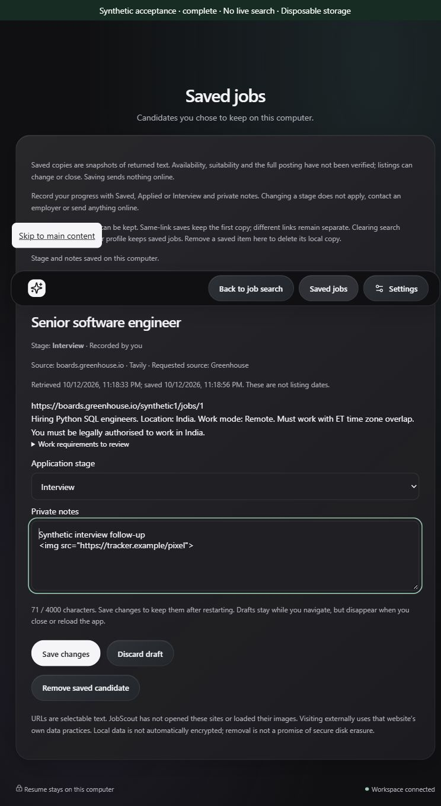
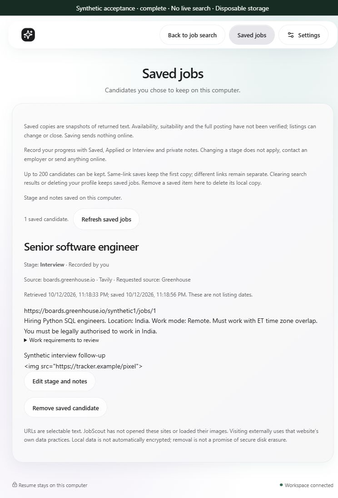
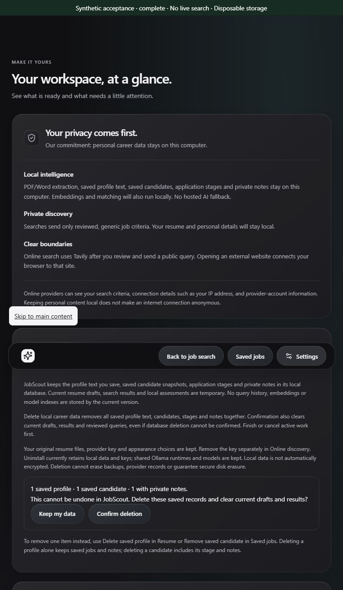
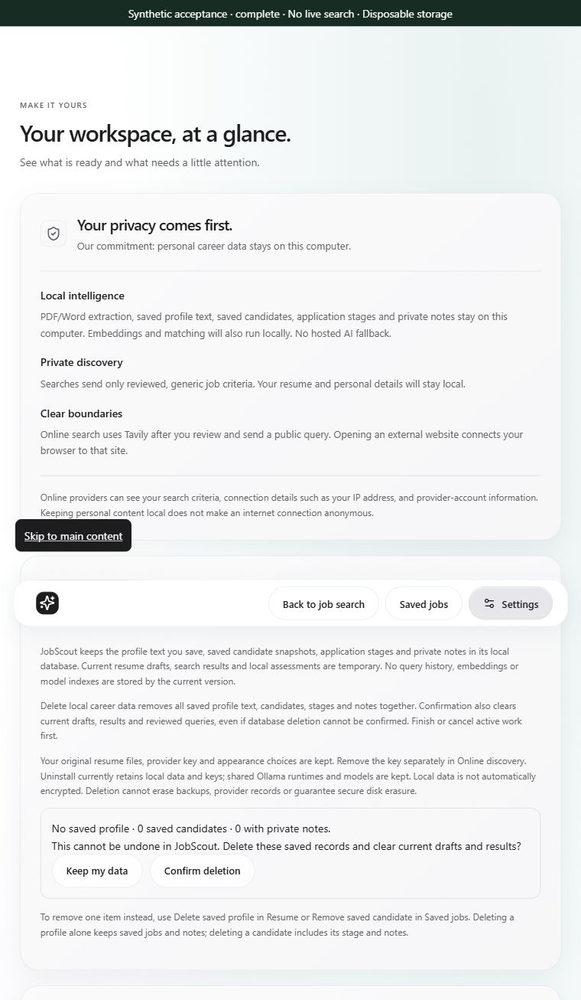

# Progress — 2026-10-12

## Milestone 18 — bounded local candidate saving

Resumed the 2026-10-11 delivery-reset checkpoint and its next milestone, preserving the existing local/unpublished documentation changes. [Decision 0032](../architecture/0032-bounded-local-job-snapshots.md) adds one coherent feature: explicitly save a selected returned candidate and review/remove it locally later. Results and repeated-role alternatives each have their own Save candidate action; Saved jobs is available from the main navigation without discarding discovery.

The local database retains a bounded first snapshot per canonical URL: title/snippet, safe link, provider/source index, retrieval time, UUID and save time. Additive schema marker 2 preserves old profiles. Atomic count/insert limits storage to 200 records, and bounded input/text sizes apply; no silent eviction or automatic overwrite/refresh. Different links remain separate. Saved jobs are not verified vacancies, suitable opportunities or current listings. Full text is treated as untrusted plain text; work-requirement quotes are recomputed from the saved snapshot without personal eligibility inference.

New fixed session-authenticated local endpoints, Tauri command and restrictive development proxy support load/confirmed save/idempotent UUID removal. SQLite operations run off the event loop. Input and response validation reject extra fields, unsafe links, malformed timestamps/provenance and unsupported data without raw error echoes. Frontend writes wait for acknowledgement; uncertain outcomes preserve the last loaded view and require reload before another mutation. Reconnection during a write queues a read and never repeats the write. Removal starts with Keep candidate focused, restores the original control on cancellation and focuses the Saved jobs heading after confirmed deletion.

Saving/loading/removal never use provider transport, credentials, model inference or page retrieval. Explicit projection excludes query history, resume/profile text and match explanations. Existing storage requires no new setup; display preferences remain separate browser/webview settings. Clearing results/profile deletion retain saved records; explicit per-item removal deletes the owned SQLite copy with secure-delete enabled. Existing uninstall data retention applies. No encryption or secure-disk-erasure claim; comprehensive controls remain milestone 20. No dependency, model, public search criterion/budget or application-version change.

## Verification

- **355 engine tests pass** in 10.69 seconds, with one existing TestClient deprecation warning. New checks cover fresh-app restart and deletion, distinctive byte removal from app-owned files, same-link immutable first-copy retention, idempotent removal, old-schema/profile preservation, concurrent capacity enforcement, rollback/closed handles, fixed storage failures, strict input/body/authentication boundaries and forbidden provider/vault/model/network access. Initial restricted targeted run stalled without output and was interrupted; scoped process permission completed the full suite. One initial surrogate test failed in the client serializer before reaching the API; escaped JSON now exercises the intended boundary and passes.
- **113 frontend tests pass**, including saved-field projection, fixed local transport, validated safe snapshots, per-alternative controls, duplicate retention, delayed acknowledgement, ambiguous-write reload recovery, disconnect/reconnect and retained-view recovery. Existing filter/evidence/privacy checks pass.
- **Nine existing synthetic pools and clean-pool evaluation pass**, retaining 72/72 reviewable labels. This is regression evidence, not live representative quality or freshness.
- **Typecheck, production frontend build, frozen production engine, paired Rust build/native command compilation and NSIS packaging pass.** Final installer: 23,217,574 bytes (22.14 MiB); normal identity/version stays JobScout 0.1.0. Final frontend/focus/disclosure edits are included in the package. No installer execution, native job-saving interaction or new resource measurements.
- **Synthetic browser interaction:** one five-source mocked run returned fifty links. Enter saved a primary candidate; keyboard expansion/Space saved its separate same-title alternative; a markup-bearing candidate was saved as escaped text. All three survived Clear results and a browser reload. Cancellation retained its record and restored focus; confirmed independent removals reduced three → two → one → zero, with zero after another reload. At 760 × 640, Light/Dark layouts are readable and document width is 745 px; no image/script/iframe elements appear in the result content. Two screenshots below use only disposable synthetic data. This is browser evidence, not an installed/native app restart.

Preview cleanup: restored the original Follow system appearance, reset the viewport and closed the agent-created preview tab. Stopped the owned synthetic launcher; read-only process inspection found zero matching preview runtime processes. Older interrupted directories were not touched. No live provider/page request, vault read/write, model operation, spending, commit or push. Build artifacts and test data remain ignored; committed-facing evidence contains only synthetic information.

## Next concrete action and release limits

**19 — simple application tracking:** stages Saved/Applied/Interview and private local notes for saved records, with restart/deletion/failure evidence. Tracking does not submit an application. Continue one coherent increment at a time.

17D remains core acceptance complete under decision 0031. Representative quality remains owner 21; native/installed saving, genuine installed schema upgrade, active-work lifecycle, full accessibility/OS and workload resources remain owner 23. Broader deletion controls belong to 20. These are still v1.0 release gates. No installed-current-binary, suitability, full Windows readiness or publication claim follows from these checks. Updated README, privacy, roadmap, release sequence, acceptance continuation and project memory; all changes remain local/unpublished.

Closeout: 165 local Markdown targets across 16 changed/new documents resolve; diff whitespace and ignored installer/test-data checks pass. Current checkpoint, release plan and roadmap identify milestone 19 as next. Yesterday's uncommitted delivery-reset documents remain present.

## Authorized publication

The user explicitly requested pushing these changes. Refreshed the remote and verified its starting commit matched local HEAD; no incoming divergence. Reviewed/staged all 36 intended code, documentation, test and labeled synthetic-image files, including the 2026-10-11 delivery reset. Diff whitespace and private-content/artifact checks pass; ignored installers, runtime caches and local test/private data are excluded.

Committed implementation as `4ab4914` — Add bounded local job saving after core acceptance — and pushed to `origin/main`. Remote-ref verification returned the exact implementation commit. Updated the current memory checkpoint to record publication. No runtime change or new test/build/installer/provider/model operation in this publication follow-up; the preceding 355 engine/113 frontend and package evidence applies. Version remains 0.1.0, next milestone remains 19, and quality/Windows release gates remain owners 21/23.

## Milestone 19 — private application tracking

Continued from the published milestone-18 checkpoint with one coherent feature, [decision 0033](../architecture/0033-private-application-tracking.md). Saved jobs now offers reversible user-recorded Saved/Applied/Interview stages and bounded private notes. Edit stage and notes opens labeled controls; Save changes explicitly persists them. Tracking does not apply, submit or contact an employer. No provider/page request, credential/model operation, extra outbound criterion, dependency/setup/version change or spending.

Additive schema marker 3 preserves existing profiles and saved snapshots, defaults older records to Saved/empty notes and maintains first-copy same-link retention. An authenticated fixed local PATCH checks a record revision transactionally before updating stage/notes; conflicts cannot silently overwrite a newer copy and missing candidates cannot be recreated. Streamed request bounds, no-store responses, fixed errors, thread-pool storage, native transport and the existing restricted proxy preserve the local boundary.

Drafts stay in memory during navigation and disappear on close/reload with explicit guidance. Acknowledgement is required before changing the stored view. Uncertain writes lock further mutations pending reload; reconnect reads without retrying notes. A stale draft shows latest stored details and requires explicit discard before editing again. Confirmed candidate removal also deletes its notes/stage and clears its draft. Profile deletion/results clearing keep tracker records. No encryption, secure-erasure or backup-removal promise; broader controls remain 20.

### Verification

- **370 engine tests pass** in 9.48 seconds, with the existing TestClient deprecation warning. Added restart/update/clear/delete and distinctive byte-removal, version-2 migration/repeat initialization, immutable snapshot/duplicate retention, invalid/auth/body-boundary, concurrent revision-conflict, rollback/closed-handle and fixed failure checks. Existing no-provider/vault/model/network test now exercises private tracking. Initial restricted targeted run stalled and was interrupted; scoped process permission completed the full suite.
- **117 frontend tests pass**, including snapshot-preserving updates, delayed acknowledgement, uncertain update/reconnect recovery without retry, conflict/read recovery, field bounds, fixed local-route projection, safely escaped private notes and disabled stale-draft save. Final Settings disclosure is included in the passing suite.
- **Existing nine diagnostic pools and clean-pool evaluation pass**; 72/72 reviewable labels remain. This is synthetic regression evidence, not representative quality.
- **Synthetic browser flow:** Enter saved a candidate, Space opened editing, Applied plus multiline markup-bearing notes survived navigation and browser reload. Interview update and explicit draft discard passed. Removal cancellation kept notes and restored focus; confirmed removal remained absent after reload. At 760 x 640, Light/Dark editor/stored views are readable, width is 745 px and no result image/script/iframe elements appear. Browser reload is not native restart. Screenshots use disposable synthetic information only.

Browser cleanup restored Follow system, reset the viewport and closed the preview tab. Owned launcher stopped; scoped read-only process check returned zero matching preview runtimes. Initial restricted preview could not be reached; the disposable preview ran with scoped local process permission. No ACL changes or unrelated process termination.

Production frontend typecheck/build and engine freezing pass. Initial restricted Windows packaging failed to canonicalize generated dist with access denied; scoped packaging compiled the Rust/native tracking command and produced NSIS. Final packaging closeout below includes the updated Settings privacy disclosure. No installer execution, native/installed tracking interaction, genuine installed migration or workload-resource measurement.

Next: **20 — privacy and data controls** across profile, saved jobs and notes, with explicit retention/deletion and failure evidence. 17D stays core acceptance complete; quality remains owner 21 and full Windows/accessibility/resources/CI release acceptance remains owner 23. Version stays 0.1.0. Current tracker implementation and documentation changes are local/unpublished; earlier milestone-18 publication remains historical.

### Tracking closeout

Final paired frontend/engine/Rust/native-bridge and NSIS package passes: installer 23,217,057 bytes (22.14 MiB), JobScout 0.1.0. The package includes the updated Settings privacy disclosure; no installer execution or native/installed tracker acceptance follows.

142 local Markdown targets across the changed/new documentation resolve; diff whitespace passes. Generated installers, caches and synthetic test data remain ignored. Checkpoint/roadmap/release plan agree on milestone 20 as next; tracker changes remain local/unpublished.

### Authorized tracker publication

The user explicitly requested pushing these changes. Refreshed the configured remote; fetched main and local HEAD both started at `147e177`, with no incoming divergence. Reviewed/staged the 26 intended implementation, test, documentation and labeled synthetic-image files. Whitespace checks pass; installers, runtime caches and local test/private data remain ignored and excluded.

Committed as `e1e6c04` — Add private application stages and notes — and pushed to remote main. Remote-ref verification returned the exact full implementation hash. Updated the checkpoint to record verified publication; milestone 20 remains next and quality/Windows release gates remain owners 21/23. No runtime change, new test/build/installer/provider/model operation or spending in this publication follow-up; preceding 370 engine/117 frontend and package evidence retains its limits. Version remains 0.1.0.

## Milestone 20 — reviewed privacy and data controls

[Decision 0034](../architecture/0034-local-career-data-controls.md) adds Settings → Your local data: count-only review followed by explicit combined career-record deletion. Keep my data starts focused, preserves records/drafts and restores focus. Confirm deletion removes saved profile/candidate snapshots/stages/notes in one transaction and releases current session copies. Individual profile/candidate removal remains available. No provider/page/vault/model operation, spending, dependency/schema/setup/version change or publication.

The inventory covers current durable SQLite rows and transient import/review/query/results/analysis/tracker/filter state. Original resumes, appearance settings, OS-vault keys, shared models/runtimes and external backups/provider records remain; removal/uninstall/unencrypted-storage/secure-erasure limits are explicit. No persisted query history, embeddings or derived career-content disk cache currently exists; future retention must extend controls before activation.

Engine GET/DELETE routes authenticate, restrict fields, bound body/read time, return no-store and never expose text/notes. A session-bound opaque review token represents exact current rows. The SQLite transaction checks reviewed state before deleting both tables; changed data requires fresh review, rollback retains both tables and handles close. Existing secure-delete/DELETE journaling supports logical owned-byte deletion. An operation boundary protects active profile/job/import/search/analysis work and rejects overlapping writes/deletion; unauthorized overlapping requests still return 401. Schema markers/database readiness remain.

Confirmation remounts the workflow, aborting/releasing current import references and invalidating local-analysis/discovery replies. Profile/job views, note drafts, reviewed text/query, results and filters clear while data-control progress persists in Settings. Uncertain or stale-connection acknowledgement locks work pending an explicit read of remaining records, never retrying deletion. This is logical release, not managed-memory zeroing or secure erasure. Confirmation discloses that drafts/results clear even if disk deletion fails.

### Verification

- **382 engine tests pass** in 10.12 seconds, with the existing TestClient deprecation warning. Restart/no-profile/no-jobs, distinctive profile/snippet/note byte-removal from owned files, original-file preservation, malformed/auth/body/duplicate-field limits, exact reviewed-state/session binding, atomic rollback/closed handles, fixed failure responses, concurrent active-write/deletion protection, and no-provider/vault/model/network checks pass. No restricted-harness stall in the scoped full run.
- **126 frontend tests pass.** New tests cover strict count-only/token response validation, no-side-effect cancellation, acknowledgement delay, lost committed-write recovery, reconnect without delete retry, invalidated old review and late delete acknowledgement, safe fixed transport projection, retention disclosures and disabled active-work/disconnected confirmation. Initial static-render assertion incorrectly expected camel-case autofocus; HTML-case assertion corrected and the suite passes.
- **Nine existing diagnostic pools and clean-pool evaluation pass**, retaining 72/72 reviewable labels. Synthetic regression evidence does not establish representative discovery quality.
- **Synthetic browser:** imported and saved a disposable DOCX profile, performed one mocked discovery, saved one Interview candidate with a note, then retained a distinct unsaved note draft. Cancellation preserved saved data/draft and restored the review button focus. Confirmation cleared profile/saved-note/draft/file-name markers from all DOM text, removed text editors, reset search steps, emptied Saved jobs and focused Your local data. Reload review returned no saved profile/zero candidates/zero notes; mocked key state and appearance remained. At 760 x 640, Light/Dark data-review views are readable; document width 745 px. Original synthetic fixture remains. Browser reload is not native app restart.

Cleanup restored Follow system, reset the viewport, closed the agent-created preview tab and stopped the launcher. Scoped read-only process inspection found zero matching preview runtimes; no ACL changes or unrelated process termination. Fixture/test storage remains ignored.

Production frontend typecheck/build and engine freezing pass. Initial restricted Windows packaging failed to canonicalize generated dist with access denied; scoped paired rebuild compiled the native data command and packaged NSIS. Final packaging closeout below includes the authentication-during-deletion safeguard. No installer execution, installed/native data-control interaction, genuine installed upgrade or workload-resource measurement.

Updated README/privacy/roadmap/releases/installation guidance and project checkpoint. Current milestone-20 implementation/documents remain local/unpublished; milestone-19 publication is historical. **Next: 21 — representative search-quality review**, starting with independently reviewed cases/existing offline evidence and the largest demonstrated discovery weakness. Additional live/provider/page requests need a fresh exact reviewed plan. 17D stays core acceptance complete; broader Windows/accessibility/resources/CI evidence remains owner 23 and v1.0 release readiness remains unclaimed. Version remains 0.1.0.

### Data-controls closeout

Final paired production frontend/engine/Rust/native-command and NSIS packaging passes: installer 23,229,400 bytes (22.15 MiB), JobScout 0.1.0. The package includes authentication preservation during overlapping deletion. No installer execution or native/installed data-control verification follows.

154 local Markdown targets across changed/new documents resolve; diff whitespace passes. Generated installer, build caches, synthetic import fixture and test data remain ignored. Checkpoint/roadmap/release plan agree on milestone 21 as next; current changes are local/unpublished.

### Milestone 20 publication

On explicit user authorization, committed and pushed all 24 reviewed milestone-20 implementation, test, documentation and synthetic screenshot files as `6b50bdb` — Add reviewed local career-data deletion controls. Verified remote main exactly matches `6b50bdb0b8240e0e91ae1cdca097197ff8e76ccd`. Generated installers, build caches, synthetic import fixtures and local test/private data remain ignored and excluded. Updated the project checkpoint and current roadmap publication status. No runtime change, installer execution, provider operation or new release-acceptance claim. Next remains milestone 21.