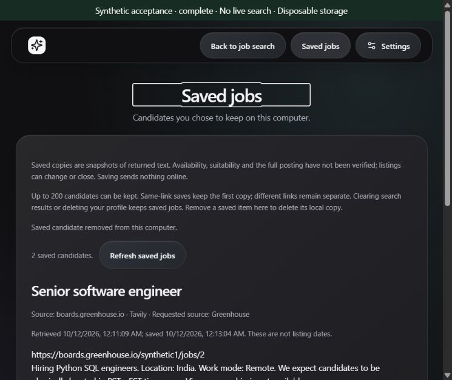
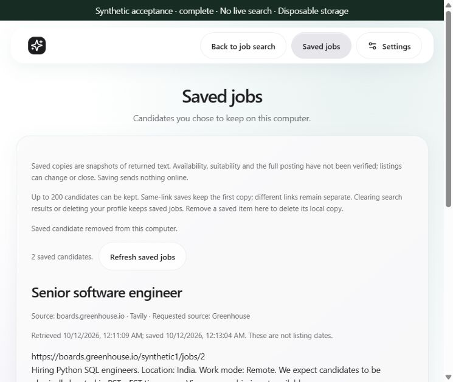

# Progress — 2026-10-12

## Milestone 18 — bounded local candidate saving

Resumed the 2026-10-11 delivery-reset checkpoint and its next milestone, preserving the existing local/unpublished documentation changes. [Decision 0032](../architecture/0032-bounded-local-job-snapshots.md) adds one coherent feature: explicitly save a selected returned candidate and review/remove it locally later. Results and repeated-role alternatives each have their own Save candidate action; Saved jobs is available from the main navigation without discarding discovery.

The local database retains a bounded first snapshot per canonical URL: title/snippet, safe link, provider/source index, retrieval time, UUID and save time. Additive schema marker 2 preserves old profiles. Atomic count/insert limits storage to 200 records, and bounded input/text sizes apply; no silent eviction or automatic overwrite/refresh. Different links remain separate. Saved jobs are not verified vacancies, suitable opportunities or current listings. Full text is treated as untrusted plain text; work-requirement quotes are recomputed from the saved snapshot without personal eligibility inference.

New fixed session-authenticated local endpoints, Tauri command and restrictive development proxy support load/confirmed save/idempotent UUID removal. SQLite operations run off the event loop. Input and response validation reject extra fields, unsafe links, malformed timestamps/provenance and unsupported data without raw error echoes. Frontend writes wait for acknowledgement; uncertain outcomes preserve the last loaded view and require reload before another mutation. Reconnection during a write queues a read and never repeats the write. Removal starts with Keep candidate focused, restores the original control on cancellation and focuses the Saved jobs heading after confirmed deletion.

Saving/loading/removal never use provider transport, credentials, model inference or page retrieval. Explicit projection excludes query history, resume/profile text and match explanations. Existing storage requires no new setup; display preferences remain separate browser/webview settings. Clearing results/profile deletion retain saved records; explicit per-item removal deletes the owned SQLite copy with secure-delete enabled. Existing uninstall data retention applies. No encryption or secure-disk-erasure claim; comprehensive controls remain milestone 20. No dependency, model, public search criterion/budget or application-version change.

## Verification

- **355 engine tests pass** in 10.69 seconds, with one existing TestClient deprecation warning. New checks cover fresh-app restart and deletion, distinctive byte removal from app-owned files, same-link immutable first-copy retention, idempotent removal, old-schema/profile preservation, concurrent capacity enforcement, rollback/closed handles, fixed storage failures, strict input/body/authentication boundaries and forbidden provider/vault/model/network access. Initial restricted targeted run stalled without output and was interrupted; scoped process permission completed the full suite. One initial surrogate test failed in the client serializer before reaching the API; escaped JSON now exercises the intended boundary and passes.
- **113 frontend tests pass**, including saved-field projection, fixed local transport, validated safe snapshots, per-alternative controls, duplicate retention, delayed acknowledgement, ambiguous-write reload recovery, disconnect/reconnect and retained-view recovery. Existing filter/evidence/privacy checks pass.
- **Nine existing synthetic pools and clean-pool evaluation pass**, retaining 72/72 reviewable labels. This is regression evidence, not live representative quality or freshness.
- **Typecheck, production frontend build, frozen production engine, paired Rust build/native command compilation and NSIS packaging pass.** Final installer: 23,217,574 bytes (22.14 MiB); normal identity/version stays JobScout 0.1.0. Final frontend/focus/disclosure edits are included in the package. No installer execution, native job-saving interaction or new resource measurements.
- **Synthetic browser interaction:** one five-source mocked run returned fifty links. Enter saved a primary candidate; keyboard expansion/Space saved its separate same-title alternative; a markup-bearing candidate was saved as escaped text. All three survived Clear results and a browser reload. Cancellation retained its record and restored focus; confirmed independent removals reduced three → two → one → zero, with zero after another reload. At 760 × 640, Light/Dark layouts are readable and document width is 745 px; no image/script/iframe elements appear in the result content. Two screenshots below use only disposable synthetic data. This is browser evidence, not an installed/native app restart.

Preview cleanup: restored the original Follow system appearance, reset the viewport and closed the agent-created preview tab. Stopped the owned synthetic launcher; read-only process inspection found zero matching preview runtime processes. Older interrupted directories were not touched. No live provider/page request, vault read/write, model operation, spending, commit or push. Build artifacts and test data remain ignored; committed-facing evidence contains only synthetic information.

## Next concrete action and release limits

**19 — simple application tracking:** stages Saved/Applied/Interview and private local notes for saved records, with restart/deletion/failure evidence. Tracking does not submit an application. Continue one coherent increment at a time.

17D remains core acceptance complete under decision 0031. Representative quality remains owner 21; native/installed saving, genuine installed schema upgrade, active-work lifecycle, full accessibility/OS and workload resources remain owner 23. Broader deletion controls belong to 20. These are still v1.0 release gates. No installed-current-binary, suitability, full Windows readiness or publication claim follows from these checks. Updated README, privacy, roadmap, release sequence, acceptance continuation and project memory; all changes remain local/unpublished.

Closeout: 165 local Markdown targets across 16 changed/new documents resolve; diff whitespace and ignored installer/test-data checks pass. Current checkpoint, release plan and roadmap identify milestone 19 as next. Yesterday's uncommitted delivery-reset documents remain present.

## Authorized publication

The user explicitly requested pushing these changes. Refreshed the remote and verified its starting commit matched local HEAD; no incoming divergence. Reviewed/staged all 36 intended code, documentation, test and labeled synthetic-image files, including the 2026-10-11 delivery reset. Diff whitespace and private-content/artifact checks pass; ignored installers, runtime caches and local test/private data are excluded.

Committed implementation as `4ab4914` — Add bounded local job saving after core acceptance — and pushed to `origin/main`. Remote-ref verification returned the exact implementation commit. Updated the current memory checkpoint to record publication. No runtime change or new test/build/installer/provider/model operation in this publication follow-up; the preceding 355 engine/113 frontend and package evidence applies. Version remains 0.1.0, next milestone remains 19, and quality/Windows release gates remain owners 21/23.
